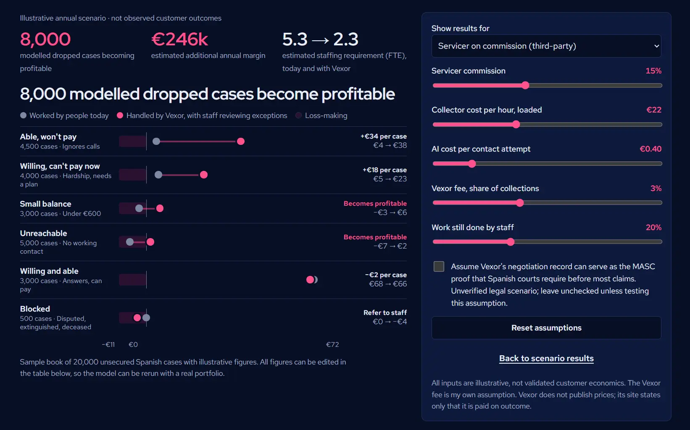

# Vexor AI business case

Independent product strategy exercise examining which debt collection segments could become economically viable with AI-assisted operations.

- [Interactive scenario model](https://anewpriya.github.io/vexor-case-study/)
- [Original November 2026 submission (PDF)](Vexor_Case_Study.pdf)

## Project preview

## Model

Compare annual contribution per case, newly profitable segments and staff capacity from a servicer or debt-owner perspective. Adjust portfolio inputs, fees, recovery assumptions and human review requirements.

All inputs and outputs are illustrative, not Vexor or client data. The model excludes blocked cases, caps recovery at the outstanding balance and defaults to no legal recognition of AI negotiation records. It does not constitute legal advice or predict actual returns. The original PDF is retained as submitted; the interactive model contains subsequent refinements.

## Pilot

The proposed 90-day pilot tests economics, capacity, complaints and audit quality against a control group. Targets are hypotheses, not achieved outcomes. Critical compliance failures are a stop condition.

## Validation

Run `node tests/model.test.mjs` with Node.js 22. GitHub Actions runs the model checks automatically.

Prepared by Anupriya Singh.

## Reference sources (reviewed 26 November 2026)

- [Vexor product website](https://vexorai.eu/): vendor-reported legal work cost benchmark of 20% relative to a five-person legal team. Not independently validated and not a measured result of this case study.
- [Spanish Organic Law 1/2025, articles 5 and 10](https://www.boe.es/buscar/act.php?id=BOE-A-2025-76): prior negotiation requirements and evidence rules, subject to statutory exceptions. No confirmation that AI-generated negotiation records alone satisfy these requirements; the optional model scenario defaults off.
- All portfolio sizes, recovery rates, fee assumptions, staffing estimates and pilot thresholds are illustrative. No live pilot or customer outcome is claimed.
